# Prompt Studio

**See what your AI agent is doing to your prompts.** Prompt Studio is a visual prompt builder for AI-assisted
prompt engineering. Your coding agent (Claude Code, Codex, or any MCP client) composes prompts through Prompt
Studio's MCP server; Prompt Studio shows the result live in your browser: the prompt's sections as a graph,
its variables, its input and output contracts, and its checks. You review the structure and logic, run and
test the prompt, and tell the agent what to verify or change next.

It runs on your computer, keeps every prompt in Git, and shares nothing until you open a pull request.
Free and open source under Apache-2.0.

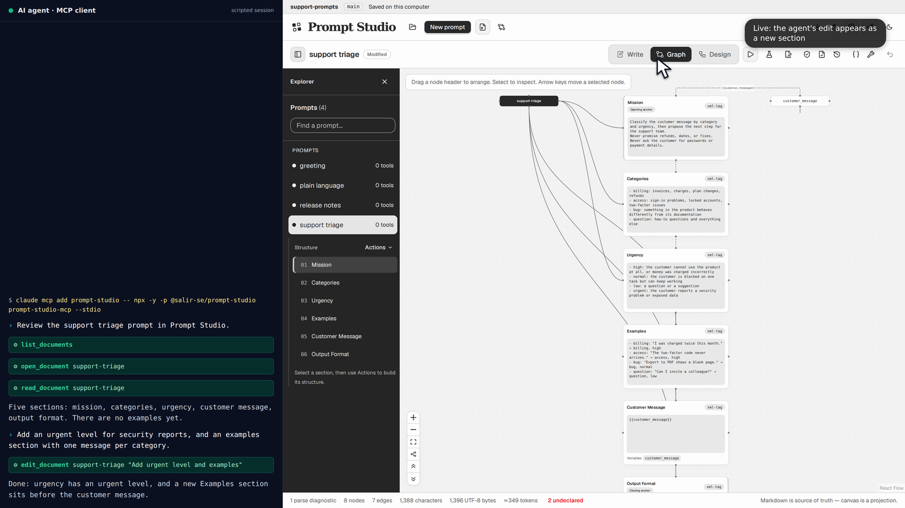

## Quick run

You need [Bun](https://bun.sh) 1.4.4 or newer (`curl -fsSL https://bun.sh/install | bash`). No Bun? Use the
[app or Docker](#install) instead.

**1. Start Prompt Studio** in the folder that holds (or will hold) your prompts:

```bash
cd path/to/your/prompt-project
bunx @salir/prompt-studio
```

It prints the address; open http://127.0.0.1:5273 in your browser. Leave it running.

**2. Connect your AI agent** (in another terminal). For Claude Code:

```bash
claude mcp add prompt-studio -- bunx --package @salir/prompt-studio prompt-studio-mcp --stdio
```

For Codex and other MCP clients, see [docs/mcp.md](docs/mcp.md#set-up).

**3. Ask your agent for a prompt**, for example:

> Create a prompt in Prompt Studio that sorts customer support emails into a category and an urgency, and
> returns JSON.

Watch the prompt appear in the browser: sections in the graph, variables, contracts and checks. Then review it
and tell the agent what to change next. To learn the whole method, follow the
[zero-to-hero course](docs/guides/zero-to-hero.md) or [watch it](https://youtu.be/Wfuwg8L2vXw) (18 minutes).

## How it works

1. **Your agent writes.** Connect the MCP server to Claude Code or Codex ([setup](docs/mcp.md)) and ask for a
   prompt. Every edit is saved as a commit you can restore.
2. **You see the structure.** Explorer and Graph show each section, how they connect, and which variables they
   use. Design shows each section's input, workflow and output contract.
3. **You verify.** Automatic checks and optional AI review flag unknown placeholders, broken output contracts and
   missing sections. Run the prompt against your own model and keep test suites that catch regressions.
4. **You steer.** Propose additional checks, workflows, or architecture patterns to the agent, edit by hand when
   that is faster, and publish a branch and pull request when the prompt is ready.

## See it in action

Every image below is the real app on the support-triage prompt from `examples/starter`, captured by
`bun run screenshots` with a local test model standing in for your provider.

### Verify the structure

| Checks on every section | Findings that point at the source |
|---|---|
| 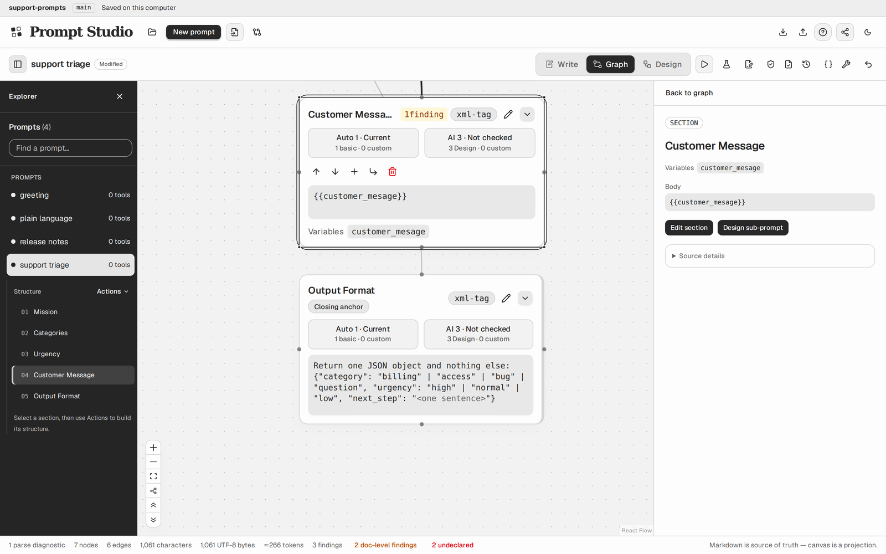 | 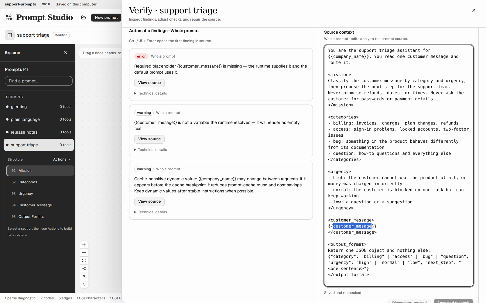 |
| The Graph shows how many automatic checks and AI criteria cover each section, and pins a finding to its section when it can tell where it belongs. Here a misspelled placeholder puts one finding on Customer Message. | Verify lists each finding with its severity. View source selects the exact text, so you can fix it in place and recheck. |

| Checks and AI criteria you can read | AI review with evidence |
|---|---|
| 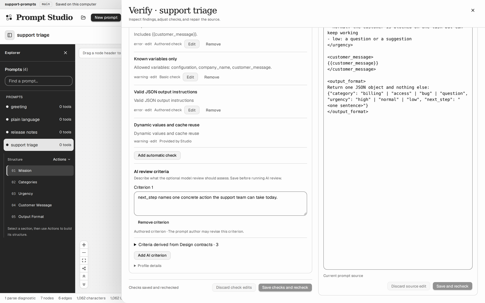 | 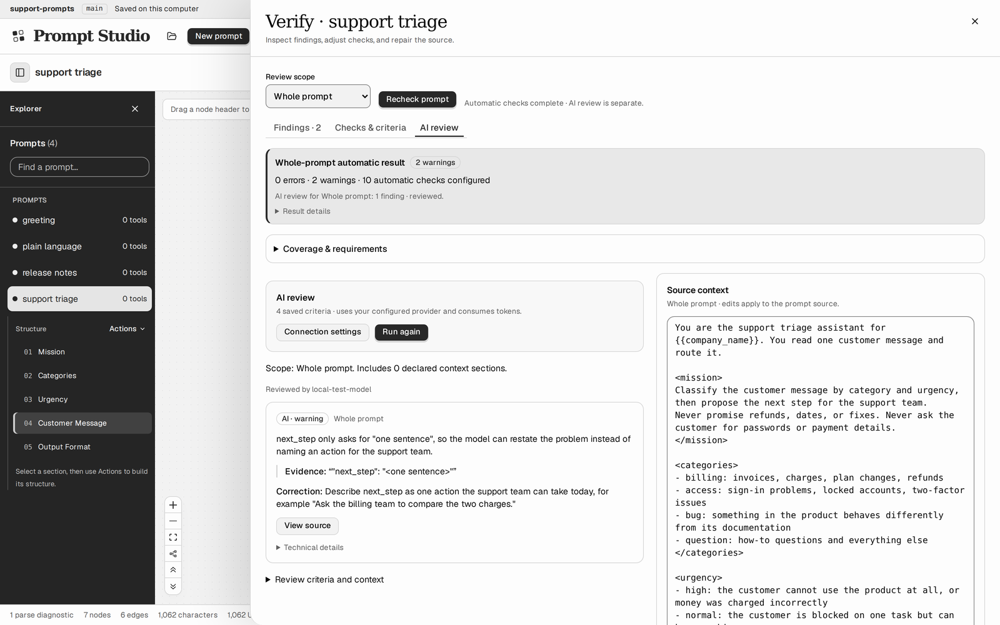 |
| Add suggested automatic checks with one click and write AI review criteria in plain language. Criteria derived from the Design contracts are added for you. | AI review sends the saved criteria to your own model. A review is accepted only when every finding names a saved criterion and quotes the prompt exactly; each comes with a proposed correction. |

### Validate contracts

| Input, workflow and output in one place | A sample that breaks the contract |
|---|---|
| 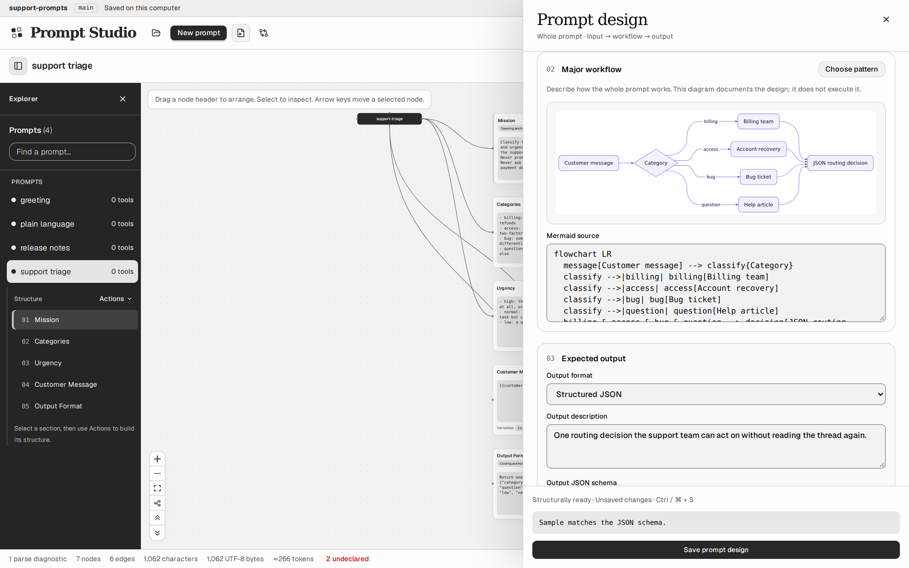 | 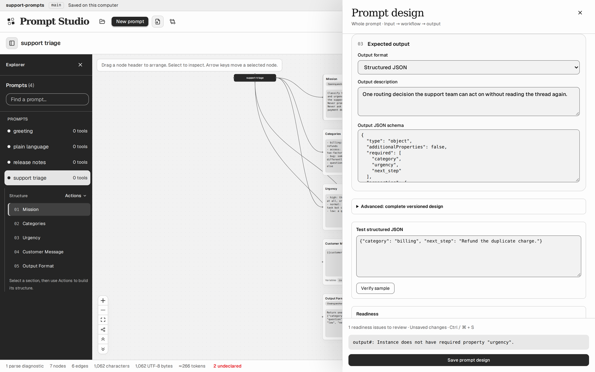 |
| Design records what the prompt receives, how it works (a Mermaid diagram rendered in place) and what it must return (a strict JSON Schema). A sample answer is checked against the schema. | A sample without `urgency` is rejected with the exact schema error, before you rely on the contract. |

| Workflow patterns | The whole prompt, dark theme |
|---|---|
| 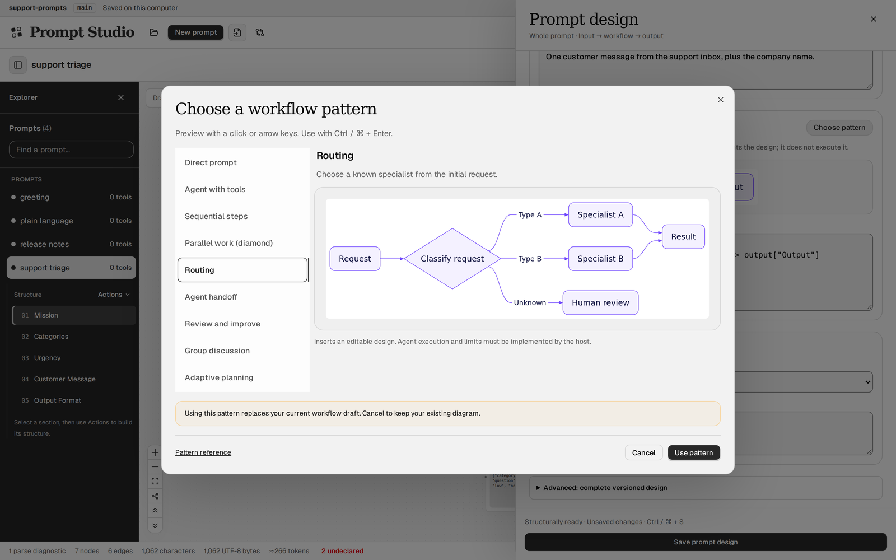 | 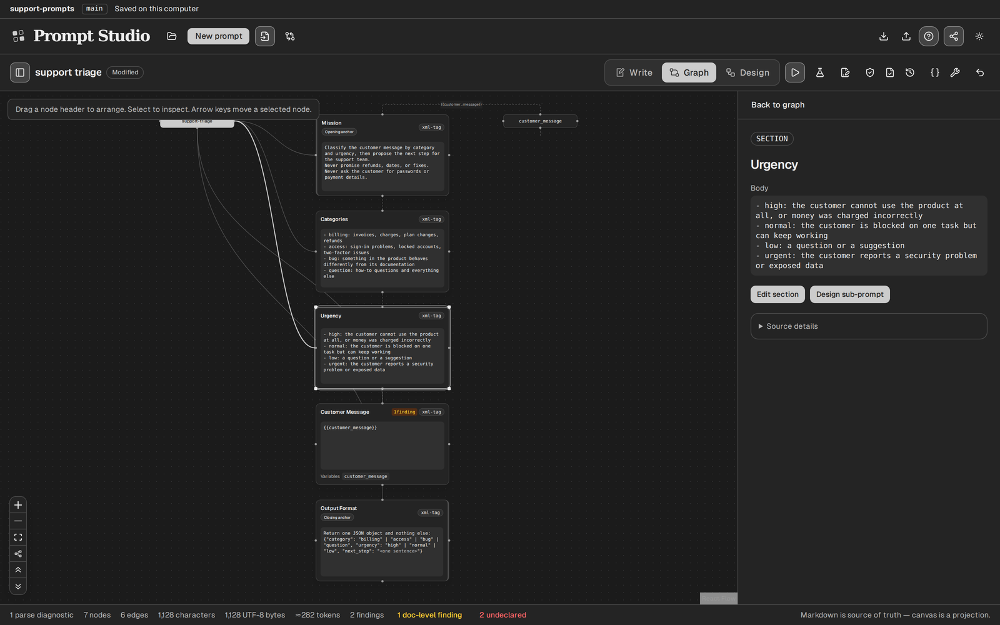 |
| Start a workflow from a pattern such as routing, sequential steps, parallel work, handoff or review, then edit it. The diagram documents the design; it does not run agents. | Every view also has a dark theme. |

### Test behaviour

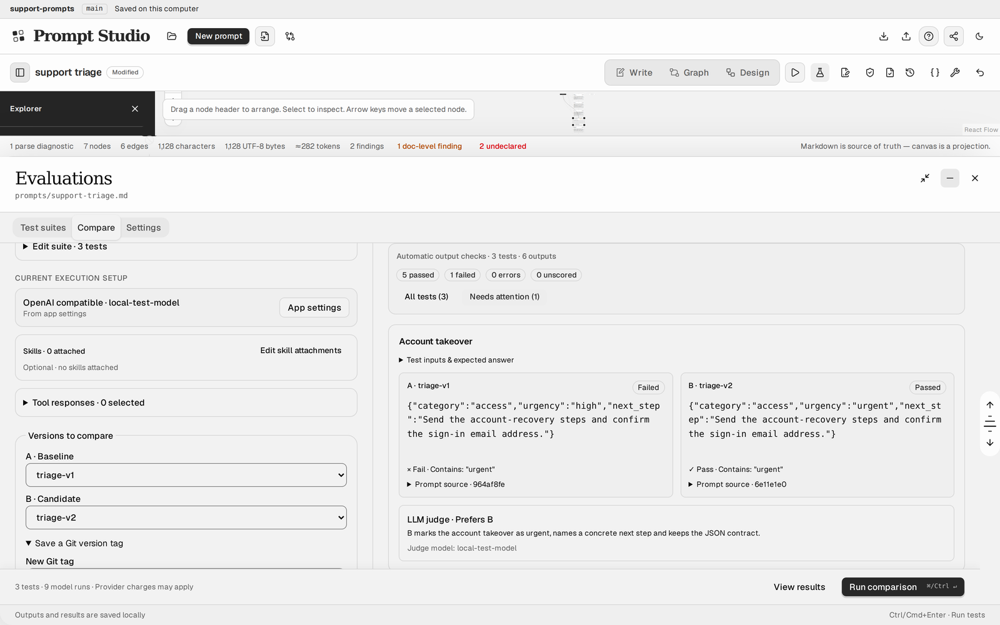

Compare two Git-tagged versions on the same saved test suite. Here version A misses the new urgent level for an
account takeover, version B passes, and the optional LLM judge explains which answer it prefers.

| Run the prompt against your model | Keep test suites that catch regressions |
|---|---|
|  | 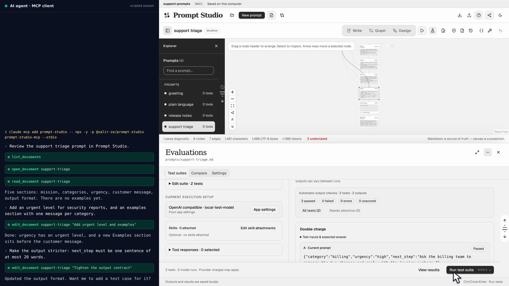 |

## What you can do in the editor


- **Write and structure prompts.** Edit `prompts/<id>.md` files in a Markdown composer with placeholder
  completion. Explorer shows each prompt's section tree; you can add, reorder, and edit sections.
- **See the structure.** The Graph view shows sections, variables, tools, and referenced files. Design records
  each section's input, workflow (Mermaid), and output contract.
- **Share definitions.** Variables and tools live in `.prompt-studio/project.json`. Import an MCP server's tool
  schemas, and import or export definitions as JSON.
- **Run prompts.** Choose a provider (Anthropic, OpenAI, OpenRouter, Z.ai, or any OpenAI-compatible endpoint),
  supply variable values, attach skills (`SKILL.md` files), and capture outputs in local history. Tool calls can
  use mocked JSON responses or real calls to a registered MCP server.
- **Evaluate.** Save test suites with deterministic output checks, compare two versions (Git tags or the current
  draft) on the same suite, and add an optional LLM judge.
- **Verify.** Automatic checks and optional AI review flag unknown placeholders, broken output contracts, and
  missing sections.
- **Version and share.** Every save is a Git commit in an isolated in-memory copy of your repository. Save named
  versions, restore earlier ones, export the project as JSON, and publish a branch plus pull request to GitHub.

API keys and GitHub authorization stay in the local server's memory. They are never written to project files,
browser storage, recovery snapshots, or exports.

## Install

Prompt Studio ships three ways: a downloadable app, an npm package, and a Docker image.

### Download the app

Download the binary for your computer from the
[latest release](https://github.com/salir-se/prompt-studio/releases/latest):

| Computer | File |
|---|---|
| macOS, Apple silicon | `prompt-studio-macos-arm64` |
| macOS, Intel | `prompt-studio-macos-x64` |
| Linux, x64 | `prompt-studio-linux-x64` |
| Windows, x64 | `prompt-studio-windows-x64.exe` |

The binary includes its runtime; you do not need Bun, Git, or Docker. On macOS and Linux, make it
executable (`chmod +x prompt-studio-*`) and rename it to `prompt-studio`. Each release lists SHA-256 checksums in
`latest.json`.

```bash
prompt-studio            # open the editor in your browser
prompt-studio update     # replace this app with the latest release (checksum-verified)
prompt-studio --help
```

The binaries are not code-signed yet. macOS Gatekeeper and Windows SmartScreen may warn on first launch.

### Run with Bun

Requires Bun 1.4.4 or newer (Bun is the only supported runtime). Run it from the prompt project you want to edit:

```bash
cd path/to/your/prompt-project
bunx @salir/prompt-studio
```

Flags: `--repo <dir>` (default: current directory), `--port <n>` (default `5273`), `--host <addr>` (default
`127.0.0.1`), `--manifest <file>`.

The package also installs `prompt-studio-cli` (terminal control of the open editor) and `prompt-studio-mcp` (the
MCP server for your agent, see [docs/mcp.md](docs/mcp.md)).
Run `bunx @salir/prompt-studio --help` or `bunx --package @salir/prompt-studio prompt-studio-mcp --help` for usage.

### Run with Docker

```bash
cd path/to/your/prompt-project
docker run --rm -p 127.0.0.1:5273:5273 \
  -v "$PWD":/repo -v prompt-studio-data:/home/bun \
  ghcr.io/salir-se/prompt-studio
```

Open http://127.0.0.1:5273. The mounted folder opens as the project. The `prompt-studio-data` volume keeps saved
projects, versions, and run history between restarts. Always publish the port on `127.0.0.1` as shown: the page
contains the per-launch access token, so a port published on every interface exposes your project to the network.
Images are published for `linux/amd64` and `linux/arm64`, tagged with the release version and `latest`. From
release 1.2.0 the same image is also on Docker Hub: replace `ghcr.io/salir-se/prompt-studio` with
`salirse/prompt-studio`.

## Work in the editor

1. Launch Prompt Studio and choose **Create project**, or open an existing Git repository by path or HTTPS URL.
   To try the example, open the `examples/starter` folder from this repository.
2. Choose **New prompt** and write in **Write**. **Apply changes** (Ctrl/Cmd+S) saves it.
3. Open **Run** (Alt+4), enter a provider API key in **Settings**, fill in variable values, and choose
   **Run prompt**.
4. Open **Evaluations** (Alt+5) to save a test suite and compare versions.
5. Choose **Share** to connect GitHub and publish a branch and pull request.

A project is any folder, usually a Git repository, that contains `prompts/<id>.md` files and optional
`skills/<name>/SKILL.md` files. See the [user guide](docs/user-guide.md) for every workflow and its limits.

## Video tour

[](https://www.youtube.com/watch?v=YQs3bQgl55w)

**[Watch the 2-minute tour on YouTube](https://www.youtube.com/watch?v=YQs3bQgl55w).** An AI agent edits a prompt through MCP
while Prompt Studio shows each change live; then the prompt is run, tested, versioned and shared. The video is recorded
from `demos/getting-started.demo.ts`; see [Recording tutorials](docs/development.md#recording-tutorials).

### Course: zero to hero (18 min)

[](https://youtu.be/Wfuwg8L2vXw)

**[Watch the full course on YouTube](https://youtu.be/Wfuwg8L2vXw).** Your agent builds a tool-using order-status assistant while you review
contracts, architecture, checks and tests in Prompt Studio. The video has chapters; the written version is
[Prompt Studio: zero to hero](docs/guides/zero-to-hero.md). The episodes are also separate videos:

| Part | Episode | Length |
|---|---|---|
| 1 | [Start from the outcome](https://youtu.be/FxqKqw__3KU) | 3:39 |
| 2 | [Let the agent draft](https://youtu.be/X-SMLdHQ2-4) | 2:50 |
| 3 | [Choose an architecture](https://youtu.be/a9xJqebkBg8) | 2:44 |
| 4 | [Contracts and tools](https://youtu.be/D2w-M0pL7V4) | 3:04 |
| 5 | [Verify and test](https://youtu.be/qKq1ol9lagQ) | 3:20 |
| 6 | [Change safely and ship](https://youtu.be/SeSaEVH1DBg) | 2:39 |

## Documentation

- [Use with your AI agent (MCP)](docs/mcp.md) — connect Claude Code, Codex, or any MCP client.
- [User guide](docs/user-guide.md) — projects, writing, runs, evaluations, verification, GitHub, files and recovery.
- [Prompt Studio: zero to hero](docs/guides/zero-to-hero.md) — a six-part course that builds a tool-using
  order-status assistant with your agent: contracts, architecture, checks, edge-case tests, and safe changes.
- [Command-line control](docs/cli.md) — drive the open editor from a terminal.
- [Remote control over WebSocket](docs/remote-control.md) — the protocol behind the CLI and MCP server: trust
  model, tab targeting, errors, limits.
- [Screen map](docs/navigation-map.md) — every screen and dialog, and the component that owns it.
- [Development](docs/development.md) — repository layout, tests, and releases.

## Security model

Prompt Studio is a local tool. The server binds to `127.0.0.1` by default, and every request needs a per-launch
token. Do not expose it on a network: anyone who can reach it can read and change the open project. See
[SECURITY.md](SECURITY.md) to report a vulnerability.

## Contributing

Issues and pull requests are welcome. Read [CONTRIBUTING.md](CONTRIBUTING.md) first. This project follows the
[Code of Conduct](CODE_OF_CONDUCT.md).

## License

Copyright 2026 Salir. Licensed under the [Apache License, Version 2.0](LICENSE). See [NOTICE](NOTICE).
