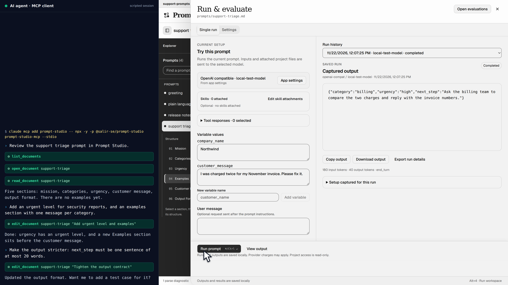

# Prompt Studio

**See what your AI agent is doing to your prompts.** Prompt Studio is a visual prompt builder for AI-assisted
prompt engineering. Your coding agent (Claude Code, Codex, or any MCP client) composes prompts through Prompt
Studio's MCP server; Prompt Studio shows the result live in your browser: the prompt's sections as a graph,
its variables, its input and output contracts, and its checks. You review the structure and logic, run and
test the prompt, and tell the agent what to verify or change next.

It runs on your computer, keeps every prompt in Git, and shares nothing until you open a pull request.
Free and open source under Apache-2.0.


## How it works

1. **Your agent writes.** Connect the MCP server to Claude Code or Codex ([setup](docs/mcp.md)) and ask for a
   prompt. Every edit is saved as a commit you can restore.
2. **You see the structure.** Explorer and Graph show each section, how they connect, and which variables they
   use. Design shows each section's input, workflow and output contract.
3. **You verify.** Automatic checks and optional AI review flag unknown placeholders, broken output contracts and
   missing sections. Run the prompt against your own model and keep test suites that catch regressions.
4. **You steer.** Propose additional checks, workflows, or architecture patterns to the agent, edit by hand when
   that is faster, and publish a branch and pull request when the prompt is ready.

## What you can do in the editor

| Run the prompt against your model | Keep test suites that catch regressions |
|---|---|
|  |  |


- **Write and structure prompts.** Edit `prompts/<id>.md` files in a Markdown composer with placeholder
  completion. Explorer shows each prompt's section tree; you can add, reorder, and edit sections.
- **See the structure.** The Graph view shows sections, variables, tools, and referenced files. Design records
  each section's input, workflow (Mermaid), and output contract.
- **Share definitions.** Variables and tools live in `.prompt-studio/project.json`. Import an MCP server's tool
  schemas, and import or export definitions as JSON.
- **Run prompts.** Choose a provider (Anthropic, OpenAI, OpenRouter, Z.ai, or any OpenAI-compatible endpoint),
  supply variable values, attach skills (`SKILL.md` files), and capture outputs in local history. Tool calls can
  use mocked JSON responses or real calls to a registered MCP server.
- **Evaluate.** Save test suites with deterministic output checks, compare two versions (Git tags or the current
  draft) on the same suite, and add an optional LLM judge.
- **Verify.** Automatic checks and optional AI review flag unknown placeholders, broken output contracts, and
  missing sections.
- **Version and share.** Every save is a Git commit in an isolated in-memory copy of your repository. Save named
  versions, restore earlier ones, export the project as JSON, and publish a branch plus pull request to GitHub.

API keys and GitHub authorization stay in the local server's memory. They are never written to project files,
browser storage, recovery snapshots, or exports.

## Install

Prompt Studio ships three ways: a downloadable app, an npm package, and a Docker image.

### Download the app

Download the binary for your computer from the
[latest release](https://github.com/salir-se/prompt-studio/releases/latest):

| Computer | File |
|---|---|
| macOS, Apple silicon | `prompt-studio-macos-arm64` |
| macOS, Intel | `prompt-studio-macos-x64` |
| Linux, x64 | `prompt-studio-linux-x64` |
| Windows, x64 | `prompt-studio-windows-x64.exe` |

The binary includes its runtime; you do not need Node, Bun, Git, or Docker. On macOS and Linux, make it
executable (`chmod +x prompt-studio-*`) and rename it to `prompt-studio`. Each release lists SHA-256 checksums in
`latest.json`.

```bash
prompt-studio            # open the editor in your browser
prompt-studio update     # replace this app with the latest release (checksum-verified)
prompt-studio --help
```

The binaries are not code-signed yet. macOS Gatekeeper and Windows SmartScreen may warn on first launch.

### Run with npm or Bun

Requires Node 22+ or Bun 1.4+. Run it from the prompt project you want to edit:

```bash
cd path/to/your/prompt-project
npx @salir-se/prompt-studio            # or: bunx @salir-se/prompt-studio
```

Flags: `--repo <dir>` (default: current directory), `--port <n>` (default `5273`), `--host <addr>` (default
`127.0.0.1`), `--manifest <file>`.

The package also installs `prompt-studio-cli` (terminal control of the open editor) and `prompt-studio-mcp` (the
MCP server for your agent, see [docs/mcp.md](docs/mcp.md)).

### Run with Docker

```bash
cd path/to/your/prompt-project
docker run --rm -p 127.0.0.1:5273:5273 \
  -v "$PWD":/repo -v prompt-studio-data:/home/bun \
  ghcr.io/salir-se/prompt-studio
```

Open http://127.0.0.1:5273. The mounted folder opens as the project. The `prompt-studio-data` volume keeps saved
projects, versions, and run history between restarts. Always publish the port on `127.0.0.1` as shown: the page
contains the per-launch access token, so a port published on every interface exposes your project to the network.
Images are published for `linux/amd64` and `linux/arm64`, tagged with the release version and `latest`.

## Quick start

1. Launch Prompt Studio and choose **Create project**, or open an existing Git repository by path or HTTPS URL.
   To try the example, open the `examples/starter` folder from this repository.
2. Choose **New prompt** and write in **Write**. **Apply changes** (Ctrl/Cmd+S) saves it.
3. Open **Run** (Alt+4), enter a provider API key in **Settings**, fill in variable values, and choose
   **Run prompt**.
4. Open **Evaluations** (Alt+5) to save a test suite and compare versions.
5. Choose **Share** to connect GitHub and publish a branch and pull request.

A project is any folder, usually a Git repository, that contains `prompts/<id>.md` files and optional
`skills/<name>/SKILL.md` files. See the [user guide](docs/user-guide.md) for every workflow and its limits.

## Video tour

A 2-minute tour of the agent workflow is recorded from `demos/getting-started.demo.ts`; see
[Recording tutorials](docs/development.md#recording-tutorials).

## Documentation

- [Use with your AI agent (MCP)](docs/mcp.md) — connect Claude Code, Codex, or any MCP client.
- [User guide](docs/user-guide.md) — projects, writing, runs, evaluations, verification, GitHub, files and recovery.
- [Command-line control](docs/cli.md) — drive the open editor from a terminal.
- [Remote control over WebSocket](docs/remote-control.md) — the protocol behind the CLI and MCP server: trust
  model, tab targeting, errors, limits.
- [Screen map](docs/navigation-map.md) — every screen and dialog, and the component that owns it.
- [Development](docs/development.md) — repository layout, tests, and releases.

## Security model

Prompt Studio is a local tool. The server binds to `127.0.0.1` by default, and every request needs a per-launch
token. Do not expose it on a network: anyone who can reach it can read and change the open project. See
[SECURITY.md](SECURITY.md) to report a vulnerability.

## Contributing

Issues and pull requests are welcome. Read [CONTRIBUTING.md](CONTRIBUTING.md) first. This project follows the
[Code of Conduct](CODE_OF_CONDUCT.md).

## License

Copyright 2026 Salir. Licensed under the [Apache License, Version 2.0](LICENSE). See [NOTICE](NOTICE).
