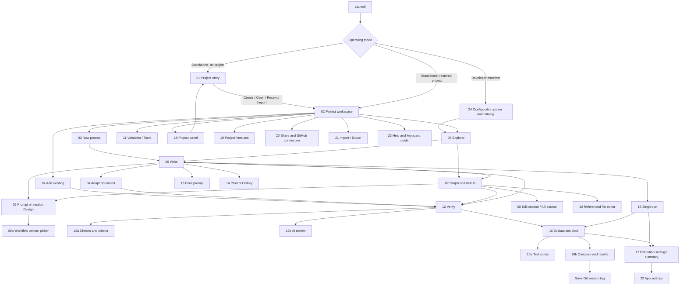

# Prompt Studio navigation map

An inventory of every screen and dialog, with the entry point and the component that owns it.
Desktop is primary; phone layouts are supported for compatibility.

## Entry and navigation model

Prompt Studio is a stateful single-page editor. Views and panels are React state, rather than separate browser
routes. The labels below are UI entry points, not URL paths. Browser Back is not a substitute for panel Close.

Two operating modes must remain visible in the inventory:

- **Standalone Studio project:** Create/Open/Recent project; starts in Write; project-owned definitions,
  local recovery, Git versions, JSON project transfer, explicit GitHub publication, Run and Evaluations.
- **Developer manifest:** starts in Graph; catalog roots/variants, browser configurations, baseline reset,
  runtime variable/tool catalogs and ZIP prompt transfer. Run and Evaluations are absent from the toolbar.

## Screen and surface inventory

"Screen" includes a substantial panel, dialog or dock with its own task. Shared menus and state variants are
listed under their owning screen. Source links are the implementation entry points.

| ID | Surface / task | Entry | Children, exits and meaningful states | Source |
|---|---|---|---|---|
| 01 | Project entry | Standalone launch without open project | Create, local/HTTPS Open, optional source branch, Recent, JSON import preview; busy/error/recovery | [PromptRepoPanel](../src/prompt-repo/PromptRepoPanel.tsx), [App](../src/App.tsx) |
| 02 | Workspace shell and empty project | Create/Open/restore | New prompt, Add existing, Explorer; save pending/saved/failed/retry, unavailable required tools, no selection | [StudioEditor](../src/StudioEditor.tsx), [StudioEmptyState](../src/components/StudioEmptyState.tsx), [ProjectSaveStatus](../src/components/ProjectSaveStatus.tsx) |
| 03 | New prompt dialog | New prompt | ID/title, optional inline tool/variable and schema details, runtime request field; create/cancel, duplicate ID/invalid JSON/saving/error | [NewPromptDialog](../src/design/NewPromptDialog.tsx) |
| 04 | Add existing / Adapt document | Toolbar or phone File / More tools | Source and Review areas, dependencies, inferred sections/contracts; save opens Verify; source/errors/working draft | [AdoptPromptDialog](../src/adoption/AdoptPromptDialog.tsx) |
| 05 | Explorer and section actions | Explorer / Alt+E | Search roots, select root/variant; section tree and Actions: edit/design/add sibling or child/reorder/remove; dock or phone drawer; no matches/unreadable/collapsed selection | [Sidebar](../src/components/Sidebar.tsx), [PromptOutline](../src/components/PromptOutline.tsx), [PromptExplorer](../src/components/PromptExplorer.tsx) |
| 06 | Write | Standalone prompt selection / Alt+1 | Markdown composer, completion and formatting, Preview draft; Apply/Discard; unapplied/stale draft, line numbers | [PromptWriter](../src/components/PromptWriter.tsx), [PromptComposer](../src/composing/PromptComposer.tsx) |
| 07 | Graph and node details | Graph / Alt+2 or Alt+R | Root/section/variable/tool/file nodes, collapse/expand, selection, fit/zoom; inspector Raw/Rendered, Back to graph, edit/design/check buttons; reference resolution states | [GraphWorkspace](../src/components/GraphWorkspace.tsx), [Inspector](../src/components/Inspector.tsx), [ProjectGraphWorkspace](../src/references/ProjectGraphWorkspace.tsx) |
| 08 | Fragment / full-source editor | Explorer Edit section or graph edit | Raw/Rendered, token completion, apply/cancel/error; root editor changes the whole document | [FragmentEditDialog](../packages/prompt-graph-ui/src/FragmentEditDialog.tsx) |
| 09 | Prompt / sub-prompt Design | Design / Alt+3 or section action | Input, Workflow, Output, contract details, tools, readiness, verification dependencies, advanced JSON, sample contract verification; save/cancel/error | [PromptDesignPanel](../src/panels/PromptDesignPanel.tsx) |
| 09a | Workflow pattern picker | Design → Choose pattern | Pattern selection and preview, Use pattern/cancel; never executes workflow | [WorkflowPatternPicker](../src/design/WorkflowPatternPicker.tsx) |
| 10 | Referenced file editor | Graph file details → Open file, or found-file edit action | Found/ambiguous/missing/outside-project; candidate selection, source editing, save/discard/close, read/save failure | [FileReferenceDetails](../src/references/FileReferenceDetails.tsx), [ReferencedFileEditor](../src/references/ReferencedFileEditor.tsx) |
| 11 | Project Variables / Tools | Toolbar or More tools | Definitions, add/edit/remove, references, JSON upload conflict preview/download; dirty/invalid schema/save failure; developer catalogs differ (24) | [ProjectDefinitionsPanel](../src/prompt-repo/ProjectDefinitionsPanel.tsx) |
| 12 | Verify overview / Findings | Verify / Alt+V, graph Auto/AI counts, successful adoption | Whole prompt or section selector; automatic result; Findings, Checks & criteria, AI review; not checked/current/stale, pending, saving/error | [VerificationPanel](../src/panels/VerificationPanel.tsx) |
| 12a | Checks & criteria | Verify tab or graph count | Presets, automatic-check CRUD and Save and recheck, explicit AI-criterion save, View source/repair; whole-prompt evaluation link | [VerificationHarness](../src/panels/verification/VerificationChecksEditor.tsx) |
| 12b | AI review | Verify → AI review | Shared execution setup, saved profiles and evidence/freshness, explicit model request; missing setup/failure | [VerificationPanel](../src/panels/VerificationPanel.tsx), [useVerificationWorkspace](../src/hooks/use-verification-workspace.ts) |
| 13 | Final prompt | Toolbar / More tools | Composed preview/source and verification artifacts, samples, mounted skills and compact AI interpretation; copy/close | [FinalPromptPanel](../src/panels/FinalPromptPanel.tsx) |
| 14 | Prompt History | History in Review controls | Commit list, restore as new commit, developer reset to shipped default; loading/empty/error | [HistoryPanel](../src/panels/HistoryPanel.tsx) |
| 15 | Single run and captured output | Run / Alt+4 (standalone only) | Variable values, provider/model/skills, Run prompt, local history, result/source snapshots/export; missing setup/loading/running/cancelled/failed/uncertain start/retry | [RunWorkspace](../src/run/RunWorkspace.tsx), [SingleRun](../src/run/SingleRun.tsx), [RunOutput](../src/run/RunOutput.tsx) |
| 16a | Evaluation Test suites | Evaluations / Alt+5 or Verify/Run link | Suite chooser, suite/case CRUD, expected answers/output checks, shared run setup; save/run, saved results, All/Needs attention | [EvaluationWorkspace](../src/run/EvaluationWorkspace.tsx), [SuiteEditor](../src/run/SuiteEditor.tsx), [EvaluationResults](../src/run/EvaluationResults.tsx) |
| 16b | Compare | Evaluations → Compare | Two Git tags or tag/current draft, save Git tag, suite, judge/rubric, run, paired outputs and separate scores/verdicts; no tags/no suite/error | [EvaluationWorkspace](../src/run/EvaluationWorkspace.tsx), [EvaluationResults](../src/run/EvaluationResults.tsx) |
| 17 | Execution settings summary | Run / Evaluations → Settings | Current provider/model/skills directory → Open app settings | [RunWorkspace](../src/run/RunWorkspace.tsx) |
| 18 | Project panel | Your prompts or phone File | Project tab: create/open/recent/import/recovery/export; separate Versions and Share tabs | [PromptRepoPanel](../src/prompt-repo/PromptRepoPanel.tsx), [ProjectRecovery](../src/prompt-repo/ProjectRecovery.tsx) |
| 19 | Project Versions | Versions command / Project tab | Save version, saved commit entries and restore; distinct from per-prompt History and evaluation Git tags | [PromptRepoPanel](../src/prompt-repo/PromptRepoPanel.tsx) |
| 20 | Share / GitHub connection | Share command / Project tab | Device authorization/link/code, advanced client ID, repository URL when needed, new branch/PR title, explicit Publish, PR link; disconnected/authorizing/failure | [PromptRepoPanel](../src/prompt-repo/PromptRepoPanel.tsx), [GithubConnection](../src/prompt-repo/GithubConnection.tsx) |
| 21 | Import / Export | Project commands or phone File | Standalone JSON archive preview creates separate project; export downloads saved project; developer ZIP dialog/validation gate | [PromptRepoPanel](../src/prompt-repo/PromptRepoPanel.tsx), [ExportDialog](../src/export/ExportDialog.tsx), [useExportImport](../src/hooks/use-export-import.ts) |
| 22 | App settings | Help menu / phone File / execution summary | Appearance tab: shortcut tips, compact toolbar preference and line numbers; Models & skills tab: shared provider/model/API key/skills folder; local preference failure vs server connection failure | [ShortcutEducation](../src/shortcuts/ShortcutEducation.tsx), [ShortcutGuide](../src/shortcuts/ShortcutGuide.tsx), [RuntimeSettings](../src/shortcuts/RuntimeSettings.tsx) |
| 23 | Keyboard guide / Help assistant | Help menu / phone File | Searchable grouped keys; separate contextual help conversation, send/pending/provider error | [ShortcutGuide](../src/shortcuts/ShortcutGuide.tsx), [HelpPanel](../src/help/HelpPanel.tsx) |
| 24 | Developer-only configuration and catalogs | Manifest mode project picker / Explorer | Baseline create/switch/rename/duplicate/reset/delete; catalog variants, declared/undeclared Variables, read-only tool catalog, developer ZIP import/export | [ProjectPicker](../src/ProjectPicker.tsx), [VariablesPanel](../src/panels/VariablesPanel.tsx), [ToolsPanel](../src/panels/ToolsPanel.tsx) |

## Cross-screen rules to preserve

- Project commands sit above selected-prompt commands. At phone widths, File holds project actions and More tools
  holds secondary prompt actions. Compact toolbars change secondary labels to icons; desktop Write / Graph / Design stay labelled. Keyboard shortcuts remain.
- Write/Graph are persistent views. Design and most auxiliary surfaces are panels, composed in
  [StudioOverlays](../src/StudioOverlays.tsx). Only one active panel is selected by
  [usePanelState](../src/hooks/use-panel-state.ts).
- Evaluations is a retained bottom dock on desktop, covering on phones; minimize/hide preserves its drafts.
  Run and Verify cover the workspace below 1280 px; other panels become covering below 768 px. Covering panels
  contain focus and make the workspace inert. Explorer has its own drawer and nested overlay behavior.
- Explorer visibility and section browsing preserve writing. Switching documents or mutating panels can require
  native discard confirmation. Run/Evaluations can consume current unapplied writing; ordinary panel transitions
  follow the existing shared guard. Close/Escape and focus return must survive future layout changes.
- Apply changes, local recovery save, Save version, Git tag and Publish have different meanings. Counts of checks
  are configuration, not pass results. Automatic checks, AI criteria and whole-prompt output tests remain distinct.
- No navigation action implicitly runs a paid model, executes tools/workflow diagrams, activates prompts in the
  Sales app or publishes to GitHub.

## Maintenance

Update this inventory when adding/moving a surface or changing its state ownership, and update the corresponding
flow in the screen review. Proposals are not implemented navigation. Visual evidence and the exact review coverage
are tracked in the dated review; this source inventory alone does not prove rendered behavior.

## Iteration 2 — MCP tool testing

- App settings → MCP servers → Register / edit address and optional bearer → Save → Discover tools.
- Project Tools → Browse MCP tools → Use definition → editable schema → Save tool.
- Run → Tool responses → select tool / alias → Predefined mock (default) or Real MCP call → Run prompt.
- Test suites → Edit suite → case → Tool responses for this test → inherit shared setup or override bindings/fixtures.
- Run output / Evaluation result → Tool calls → mode, arguments, result/error and timings; JSON export retains evidence.

Studio stores connections outside the project and never returns bearer values. Mock invocation makes no MCP request.

### Help model selection

Help → Ask the help assistant → inherits App settings → optional Separate Help model → Save Help model.
Provider connections remain in App settings; reply labels retain model identity. New conversation clears the
Help transcript. Returning to Use model from App settings resumes shared inheritance.
